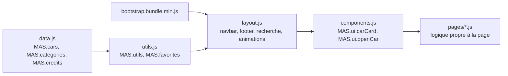

# Maserati - Collection exclusive

Site vitrine multi-pages d'une concession Maserati fictive, réalisé en **HTML, CSS, Bootstrap 5.3 et JavaScript natif**, sans framework ni étape de compilation.
Il présente la gamme, les services et les solutions de financement, et contient un formulaire de contact.

> Projet pédagogique. Les prix, caractéristiques techniques et coordonnées sont **indicatifs** ou fictifs.

---

## Sommaire

1. [Lancer le projet](#1-lancer-le-projet)
2. [Arborescence](#2-arborescence)
3. [Les pages](#3-les-pages)
4. [Architecture JavaScript](#4-architecture-javascript)
5. [Architecture CSS](#5-architecture-css)
6. [Navigation entre les pages](#6-navigation-entre-les-pages)
7. [Données enregistrées dans le navigateur](#7-données-enregistrées-dans-le-navigateur)
8. [Ajouter ou modifier un modèle](#8-ajouter-ou-modifier-un-modèle)
9. [Accessibilité et bonnes pratiques](#9-accessibilité-et-bonnes-pratiques)
10. [Crédits](#10-crédits)

---

## 1. Lancer le projet

Aucune installation n'est nécessaire : toutes les dépendances (Bootstrap, Bootstrap Icons) sont **en local**, le site fonctionne donc hors ligne.

- **Recommandé :** ouvrir le dossier dans VS Code, puis clic droit sur `index.html` → **Open with Live Server** (port 5502, configuré dans `.vscode/settings.json`).
- **Sinon :** double-cliquer sur `index.html`. Le site fonctionne aussi en `file://`, car les scripts sont classiques et non des modules ES.

---

## 2. Arborescence

```
Projets-Bootstrap iit/
│
├── index.html               Accueil
├── collection.html          Catalogue des modèles
├── services.html            Services + FAQ
├── solutions.html           Offres de financement + simulateur
├── apropos.html             Histoire, valeurs, galerie, crédits photos
├── contact.html             Formulaire de contact
├── README.md                Ce document
│
├── assets/                  ← Fichiers propres au projet
│   ├── css/
│   │   └── style.css        Styles personnalisés (complètent Bootstrap)
│   ├── js/
│   │   ├── data.js          Données : catalogue des voitures + crédits photos
│   │   ├── utils.js         Outils partagés + gestion des favoris
│   │   ├── layout.js        Navbar (vidéo), menu mobile, footer, recherche
│   │   ├── components.js    Carte voiture + fiche détaillée (modal)
│   │   └── pages/           Un script par page
│   │       ├── accueil.js
│   │       ├── collection.js
│   │       ├── services.js
│   │       ├── solutions.js
│   │       ├── apropos.js
│   │       └── contact.js
│   ├── img/
│   │   ├── logo.svg         Emblème trident (logo + favicon)
│   │   └── voitures/        Photos des modèles (.jpg / .webp)
│   └── video/
│       └── grancabrio-folgore.mp4   Vidéo de fond de la barre de navigation
│
├── css/                     ← Bibliothèques (ne pas modifier)
│   ├── bootstrap.min.css    Bootstrap 5.3.8
│   ├── bootstrap-icons.min.css   Bootstrap Icons 1.11.3
│   └── fonts/               Polices des icônes
├── js/                      ← Bibliothèque (ne pas modifier)
│   └── bootstrap.bundle.min.js   Bootstrap 5.3.8 + Popper
│
└── Myapp.html, javaScript.html, Script.js   Brouillons / exercices (hors site)
```

**Principe :** les dossiers `css/` et `js/` à la racine contiennent uniquement les **bibliothèques externes** ; tout le code écrit pour le projet se trouve dans **`assets/`**.

---

## 3. Les pages

Chaque entrée du menu ouvre une **page HTML distincte**.

| Page | Fichier | Contenu | Fonctions JavaScript |
|---|---|---|---|
| **Accueil** | `index.html` | Carrousel de photos, modèles à la une, tuiles par motorisation, « Pourquoi nous », chiffres clés, appel à l'action | Cartes générées depuis le catalogue, bouton pause du carrousel, compteurs animés |
| **Collection** | `collection.html` | Les 9 modèles | Recherche instantanée, filtres (hybride / thermique / électrique / favoris), tri, **comparateur** (jusqu'à 3 modèles, meilleure valeur signalée), fiche détaillée avec galerie |
| **Services** | `services.html` | 6 services, parcours en 4 étapes, FAQ | FAQ en accordéon avec recherche, liens « Prendre rendez-vous » pré-remplis |
| **Solutions** | `solutions.html` | Comptant, crédit, location longue durée | **Simulateur** crédit / LLD : mensualité, coût des intérêts, coût total, barre de répartition ; mémorise la dernière simulation |
| **À propos** | `apropos.html` | Histoire, frise chronologique, valeurs, galerie, crédits photos | Galerie avec **visionneuse** (flèches, clavier, glissement tactile) |
| **Contact** | `contact.html` | Coordonnées + formulaire | Validation en direct, compteur de caractères, **brouillon sauvegardé automatiquement**, pré-remplissage depuis les autres pages, statut « Ouvert / Fermé » en temps réel |

Toutes les pages partagent :
- la **barre de navigation avec la vidéo en fond**, le logo, le lien actif souligné et le compteur de favoris ;
- le menu mobile ;
- le pied de page ;
- le bouton « retour en haut » ;
- les notifications (toasts).

---

## 4. Architecture JavaScript

### 4.1 Structure d'une page

Chaque page HTML contient seulement son contenu propre et deux emplacements vides :

```html
<body data-page="collection">        <!-- identifie la page courante -->
  <div id="site-header"></div>       <!-- remplacé par la navbar -->
  <main> ... contenu de la page ... </main>
  <div id="site-footer"></div>       <!-- remplacé par le footer -->

  <script src="js/bootstrap.bundle.min.js"></script>
  <script src="assets/js/data.js"></script>
  <script src="assets/js/utils.js"></script>
  <script src="assets/js/layout.js"></script>
  <script src="assets/js/components.js"></script>
  <script src="assets/js/pages/collection.js"></script>
</body>
```

La navbar et le footer ne sont écrits **qu'une seule fois**, dans `layout.js`. Pour modifier le menu, on change un seul fichier et les 6 pages sont mises à jour.

### 4.2 Ordre de chargement et dépendances

L'**ordre des balises `<script>` est important** : chaque fichier utilise ce que les précédents ont défini.



### 4.3 Le rôle de chaque fichier

| Fichier | Responsabilité | Ce qu'il expose |
|---|---|---|
| `data.js` | **Source unique des données** : les 9 modèles (nom, prix, motorisation, photos, caractéristiques), les catégories et les crédits photos | `MAS.cars`, `MAS.categories`, `MAS.getCar(id)`, `MAS.credits` |
| `utils.js` | Outils génériques : échappement HTML (anti-XSS), formatage des prix (`85 000 €`), lecture des paramètres d'URL, accès sécurisé au `localStorage`, calcul de mensualité, *debounce*, notifications. Gère aussi la liste des favoris | `MAS.utils`, `MAS.favorites` |
| `layout.js` | Injecte la navbar et le footer, gère le menu mobile, la barre compacte au défilement, la recherche (directe sur Collection, redirection ailleurs), le badge de favoris, les animations d'apparition et les compteurs | `MAS.observeReveal()` |
| `components.js` | Composants réutilisables : la **carte voiture** (accueil + collection) et la **fiche détaillée** (modal avec carrousel). Gère les clics sur tout bouton `data-car` ou `data-fav`, même ajouté dynamiquement | `MAS.ui.carCard()`, `MAS.ui.openCar()` |
| `pages/*.js` | Logique spécifique à une seule page | — |

### 4.4 Choix techniques

- **Un seul objet global, `MAS`** : toutes les fonctions sont rangées dedans (`MAS.utils`, `MAS.ui`…) pour ne pas polluer l'espace global.
- **Les pages sont générées à partir des données** : les cartes, la liste du simulateur, celle du formulaire, la galerie et les crédits sont tous construits depuis `data.js`. Rien n'est recopié à la main.
- **Communication par évènements** : quand un favori change, `MAS.favorites` émet l'évènement `mas:favorites`, et chaque partie de la page (cœurs, badge, liste) se met à jour seule. La recherche de la navbar émet `mas:search`, écouté par la page Collection.
- **Délégation d'évènements** : un seul écouteur sur `document` gère tous les boutons « Découvrir » et « cœur », y compris ceux créés après coup.
- **Sécurité** : tout texte inséré en HTML passe par `MAS.utils.esc()`, et les paramètres d'URL sont validés avant usage (un `?modele=` inconnu est ignoré).
- **Pas de modules ES** : des scripts classiques, pour que le site fonctionne aussi en ouvrant les fichiers directement (`file://`).

---

## 5. Architecture CSS

1. **Bootstrap d'abord** : la mise en page utilise au maximum les classes utilitaires de Bootstrap (`row`, `col-md-6`, `rounded-4`, `shadow`…).
2. **`assets/css/style.css` ensuite**, pour ce que Bootstrap ne fournit pas. Le fichier est découpé en 10 sections numérotées :

| Section | Contenu |
|---|---|
| 1. Variables & base | Couleurs (`--mas-dark`, `--mas-gold`), défilement fluide |
| 2. Utilitaires | `tracking-wide`, `tracking-wider`, `tracking-widest`, `fs-7`… |
| 3. Barre de navigation | Voile sur la vidéo, soulignement animé, barre compacte au défilement |
| 4. Bandeaux de page | Image de fond avec zoom lent des pages internes |
| 5. Carrousel d'accueil | Hauteur, dégradé, légendes |
| 6. Cartes voitures | Survol, bouton favori, badges, tuiles motorisation |
| 7. Services / solutions | Icônes en dégradé, étapes numérotées, simulateur |
| 8. À propos | Frise chronologique alternée, galerie |
| 9. Contact, footer, divers | Champs, réseaux sociaux, bouton retour en haut |
| 10. Animations & accessibilité | Apparition au défilement, `prefers-reduced-motion` |

**Icônes :** le site n'utilise **aucun emoji**. Toutes les icônes viennent de [Bootstrap Icons](https://icons.getbootstrap.com/), en local (ex. `<i class="bi bi-speedometer2"></i>`).
**Logo :** `assets/img/logo.svg` est un emblème vectoriel original (trident dans un écusson) ; il reste net à toutes les tailles et sert aussi de favicon.

---

## 6. Navigation entre les pages

Les pages se transmettent des informations par l'**URL** :

| Lien | Effet |
|---|---|
| `collection.html?q=mc20` | Recherche pré-remplie |
| `collection.html?filtre=electrique` | Filtre appliqué (`hybride`, `thermique`, `electrique`, `favoris`) |
| `collection.html?tri=prix-desc` | Tri appliqué |
| `collection.html?modele=mc20` | Ouvre directement la fiche de la MC20 |
| `solutions.html?modele=mc20#simulateur` | Simulateur pré-réglé sur ce modèle |
| `contact.html?modele=mc20&sujet=essai` | Formulaire pré-rempli (modèle, sujet et message) |

Exemple de parcours : sur la **Collection**, le bouton « Réserver un essai » d'une fiche ouvre `contact.html?modele=…&sujet=essai`, et le formulaire arrive déjà rempli.
Les filtres de la Collection sont recopiés dans l'URL, ce qui permet de **partager un lien filtré**.

---

## 7. Données enregistrées dans le navigateur

Le site n'a pas de serveur. Quelques préférences sont gardées dans le `localStorage` du navigateur :

| Clé | Contenu | Utilisée par |
|---|---|---|
| `mas-favoris` | Identifiants des modèles favoris | Toutes les pages |
| `mas-simulation` | Dernière simulation (modèle, type, apport, durée) | Solutions |
| `mas-brouillon-contact` | Brouillon du formulaire. **La case de consentement n'est jamais enregistrée** ; le brouillon est effacé après l'envoi | Contact |

Si le `localStorage` est bloqué (navigation privée, par exemple), le site continue de fonctionner, simplement sans mémoire.

> **Envoi du formulaire :** l'envoi est **simulé** (aucun message ne part réellement). Pour un vrai envoi, il faudra brancher `contact.js` sur un service (back-end, Formspree, EmailJS…).

---

## 8. Ajouter ou modifier un modèle

Tout se passe dans **`assets/js/data.js`**, sans toucher au HTML :

1. Copier la photo dans `assets/img/voitures/`.
2. Ajouter une entrée dans `MAS.cars` :

```js
{
  id: 'ghibli',                       // identifiant unique (utilisé dans les URL)
  name: 'Ghibli',
  body: 'Berline',
  category: 'thermique',              // hybride | thermique | electrique
  badge: 'V6 Biturbo',
  price: 95000,
  featured: false,                    // true = affiché sur l'accueil
  tagline: 'Phrase courte pour la carte.',
  desc: 'Description longue pour la fiche détaillée.',
  images: ['assets/img/voitures/ghibli.jpg'],
  specs: { power: 430, accel: 4.7, vmax: 286, engine: 'V6 3.0 L' }  // range: 450 pour un électrique
}
```

Le modèle apparaît alors automatiquement dans la Collection, le comparateur, le simulateur, le formulaire de contact, la galerie et le pied de page.
Si la photo est sous licence libre, ajouter aussi son auteur dans `MAS.credits`.

---

## 9. Accessibilité et bonnes pratiques

- Lien « Aller au contenu » pour la navigation au clavier.
- Attributs `aria-*` sur les menus, filtres, carrousels et boutons favoris.
- Textes alternatifs sur toutes les photos.
- Messages d'erreur sous chaque champ du formulaire.
- Respect de `prefers-reduced-motion` : vidéo en pause, carrousel arrêté, pas d'animations.
- Bouton pause sur le carrousel d'accueil.
- Responsive : du mobile (375 px) au grand écran. Le menu devient un panneau sous 992 px.
- Liens externes ouverts avec `rel="noopener noreferrer"`.

---

## 10. Crédits

- **Bootstrap 5.3.8** et **Bootstrap Icons 1.11.3**, licence MIT.
- **Photographies** issues de [Wikimedia Commons](https://commons.wikimedia.org/), sous licence libre :

| Fichier (`assets/img/voitures/`) | Auteur | Licence |
|---|---|---|
| `grecale-trofeo.jpg` | Alexander Migl | CC BY-SA 4.0 |
| `grecale-gt.jpg` | Alexander-93 | CC BY-SA 4.0 |
| `levante.jpg` | Alexander Migl | CC BY-SA 4.0 |
| `quattroporte.jpg` | Alexander Migl | CC BY-SA 4.0 |
| `interieur-quattroporte.jpg` | RpM Tartar | CC BY-SA 4.0 |
| `granturismo-trofeo.jpg` | Alexander-93 | CC BY-SA 4.0 |
| `granturismo-folgore.jpg` | MrWalkr | CC BY-SA 4.0 |
| `grancabrio-trofeo.jpg` | Matti Blume | CC BY-SA 4.0 |
| `mc20.jpg` | Alexander Migl | CC BY-SA 4.0 |
| `gt2-stradale.jpg` | Charles from Port Chester, New York | CC0 |

Les liens vers chaque photo originale sont listés sur la page **À propos** (section « Crédits photos ») et dans `assets/js/data.js`.
Les fichiers `grecale.jpg`, `mc20-cielo.webp`, `grancabrio-folgore.jpg` et la vidéo `grancabrio-folgore.mp4` faisaient partie du projet d'origine.

Maserati et le trident sont des marques déposées de Maserati S.p.A. Ce site est un exercice pédagogique sans lien avec la marque.
